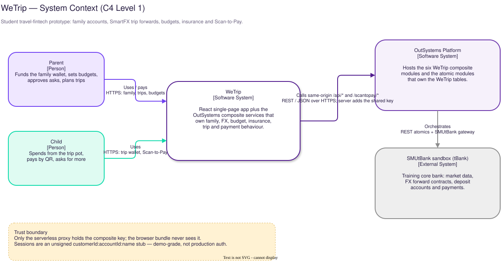
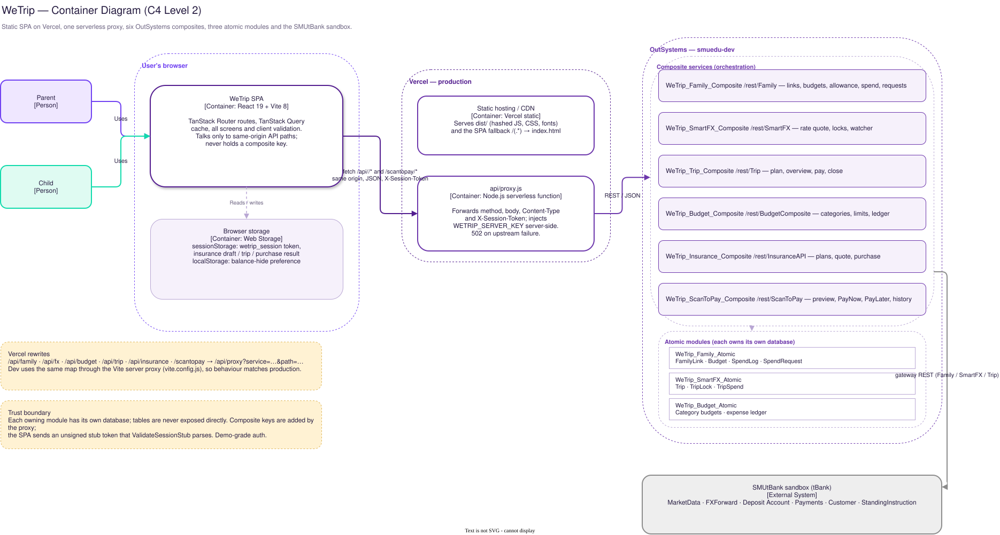
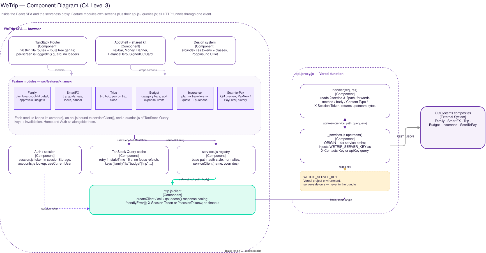
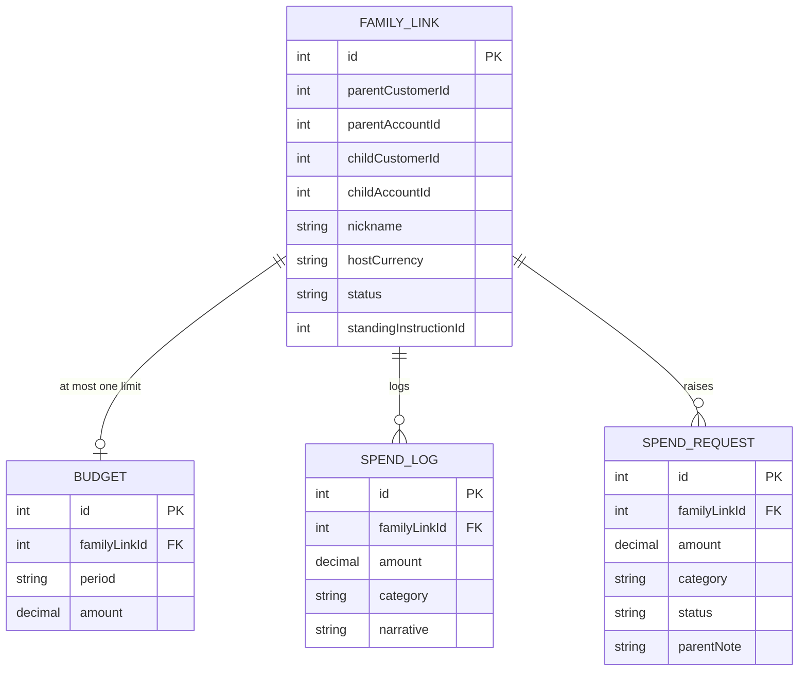
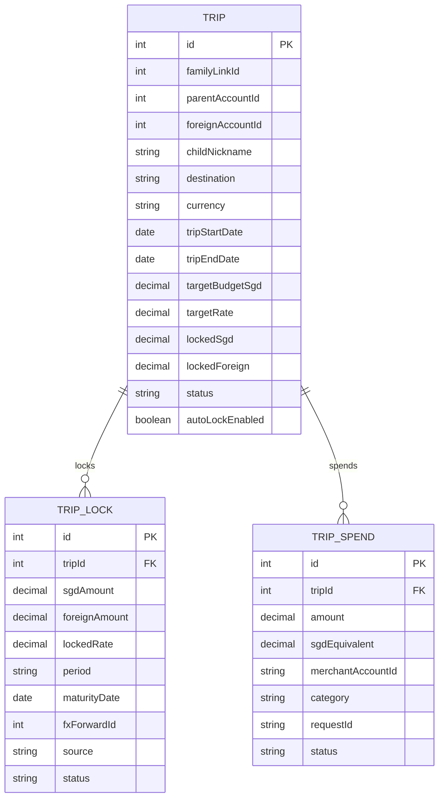
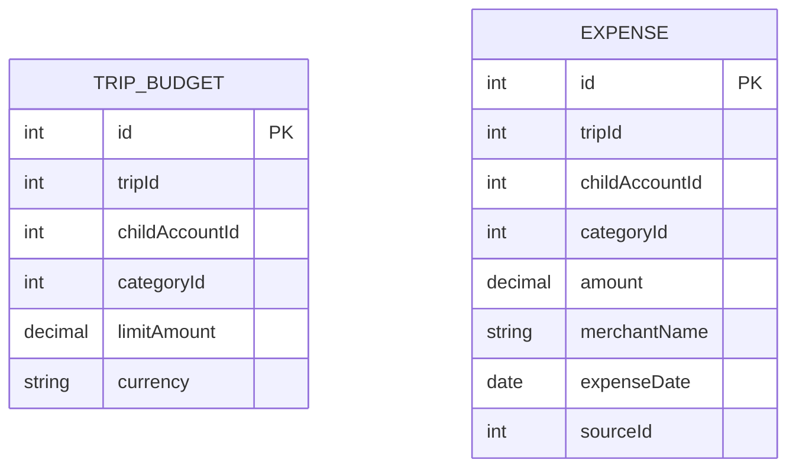
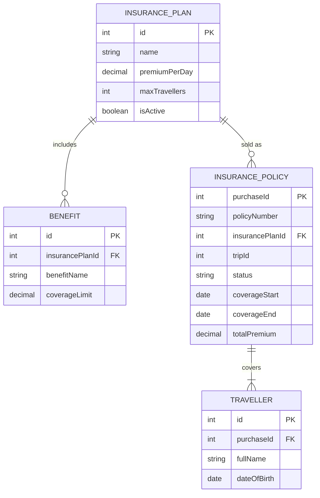
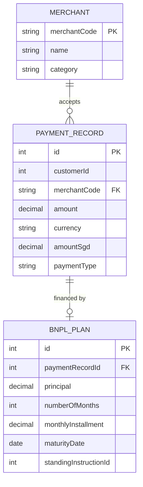

# WeTrip Architecture

WeTrip is a student travel-fintech prototype for the IS444 group project. A React single-page app (this repository) talks to six OutSystems composite services, which orchestrate WeTrip atomic modules and the SMU tBank (`SMUtBank`) sandbox.

**Scope of this document.** The frontend source, proxy and tests are in this repository. The OutSystems backend source is **not**: module and table details below are reconstructed from the frontend contract in `src/features/*/api.js`, the proxy map in `api/_services.js`, and the live contract tests in `scripts/` and `tests/`. Inferred items are tagged **[inferred]**.

Related docs: [features/](features/README.md) (one page per feature) · [DEPLOYMENT.md](DEPLOYMENT.md) · [DESIGN.md](DESIGN.md) · [PRODUCT.md](../PRODUCT.md)

The C4 diagrams are editable in [`docs/diagrams/`](diagrams) (`*.drawio`) and exported to SVG with the `rlespinasse/drawio-desktop-headless` Docker image. The ERD is inline Mermaid, so it edits as text.

## Contents

1. [System context](#1-system-context)
2. [Containers](#2-containers)
3. [Frontend components](#3-frontend-components)
4. [OutSystems backend](#4-outsystems-backend)
5. [Data model](#5-data-model)
6. [Screens](#6-screens)
7. [Cross-feature flows](#7-cross-feature-flows)
8. [Cross-cutting rules](#8-cross-cutting-rules)
9. [Known gaps and drift](#9-known-gaps-and-drift)

---

## 1. System context



| Element                  | Type            | Responsibility                                                                                                                                                        |
| ------------------------ | --------------- | --------------------------------------------------------------------------------------------------------------------------------------------------------------------- |
| Parent                   | Person          | Funds the family wallet, sets weekly/monthly limits and allowances, approves or rejects spending requests, plans trips, locks FX rates, buys insurance, closes trips. |
| Child                    | Person          | Spends from the family wallet, pays merchants by QR (wallet or trip pot), asks for more budget, views their budget and trips.                                         |
| WeTrip                   | Software system | React SPA plus the OutSystems composite services that implement family, FX, budget, insurance, trip and payment behaviour.                                            |
| OutSystems Platform      | Software system | Hosts the seven WeTrip composite modules, the atomic modules that own the WeTrip tables, and the shared API-key site properties.                                      |
| SMUtBank sandbox (tBank) | External system | Training core bank: market data, FX forward contracts, deposit accounts, customers, payments and standing instructions. Sandbox money only.                           |

The browser is untrusted and never holds a composite key. It sends an unsigned `customerId:accountId:displayName` stub token; the serverless proxy adds the shared `WETRIP_SERVER_KEY`. This is demo-grade authentication, not production auth.

---

## 2. Containers



| Container            | Technology                                        | Responsibility                                                                                                                                                                                                                         | Protocols                                                              |
| -------------------- | ------------------------------------------------- | -------------------------------------------------------------------------------------------------------------------------------------------------------------------------------------------------------------------------------------- | ---------------------------------------------------------------------- |
| WeTrip SPA           | React 19, Vite 8, TanStack Router, TanStack Query | All screens, routing, client validation, query cache, session storage. Calls only same-origin paths.                                                                                                                                   | HTTPS, JSON `fetch`; `X-Session-Token` (SmartFX also `?sessionToken=`) |
| Static hosting       | Vercel CDN                                        | Serves `dist/` (hashed JS/CSS/fonts) and the SPA fallback `/(.*) → /index.html`.                                                                                                                                                       | HTTPS                                                                  |
| `api/proxy.js`       | Node.js serverless function                       | Maps `/api/<service>/*` and `/scantopay/*` to OutSystems, injects `WETRIP_SERVER_KEY`, forwards method/body/session, returns upstream bytes. Emits `502 {"Errors":["The service did not respond"]}` when the composite is unreachable. | HTTPS to `smuedu-dev.outsystemsenterprise.com`                         |
| Vite dev server      | Vite `server.proxy`                               | Dev-only: same service map and key injection for local development and Playwright; `dev:https` adds a LAN HTTPS URL for the phone camera.                                                                                              | HTTP/HTTPS                                                             |
| Browser storage      | Web Storage                                       | `sessionStorage.wetrip_session` plus the insurance draft/trip/result; `localStorage` balance preference.                                                                                                                               | Same-origin browser storage                                            |
| Composites ×6        | OutSystems REST modules                           | Orchestration, session/role checks, table access through atomics, SMUtBank calls. Own no tables for the confirmed modules.                                                                                                             | REST/JSON                                                              |
| Atomics ×3 confirmed | OutSystems REST modules                           | Own their own databases and expose CRUD: Family, SmartFX, Budget.                                                                                                                                                                      | REST/JSON                                                              |
| SMUtBank             | External sandbox                                  | Customers, accounts, market data, FX forwards, payments, standing instructions.                                                                                                                                                        | SMUtBank gateway REST (Basic auth, server-to-server)                   |

Both proxies share [`api/_services.js`](../api/_services.js), so the browser-facing path map, upstream paths and key transport cannot drift between dev and production.

### Request path

```text
Browser
  GET /api/family/GetChildren  (X-Session-Token: customerId:accountId:displayName)
    │  Vercel rewrite /api/family/:path* → /api/proxy?service=family&path=:path*
    ▼
api/proxy.js
  upstream('family', 'GetChildren', query, process.env)
    │  https://smuedu-dev.outsystemsenterprise.com/WeTrip_Family_Composite/rest/Family/GetChildren
    │  X-Contacts-Key: WETRIP_SERVER_KEY
    ▼
WeTrip_Family_Composite → WeTrip_Family_Atomic + SMUtBank
    ▼
JSON response (PascalCase) → proxy → decap() in the browser → TanStack Query cache
```

Special cases:

- **SmartFX** cannot read request headers, so the session token rides as a `sessionToken` query parameter on every call and the key as `apiKey`; the proxy overwrites any caller-supplied `apiKey`.
- **Scan-to-Pay** uses `/scantopay` (no `/api` prefix) and passes `CustomerId` in the query, taken from the session.
- **Payments** are user-triggered only. `PayNow`, `PayLater` and `PayOnTrip` set `retry: false`; a `502/503/504` or network error is treated as "may have completed". `PayNow`/`PayLater` refresh history on settle; `PayOnTrip` refreshes the trip views.

---

## 3. Frontend components



| Component             | Location                                                     | Responsibility                                                                                                                               |
| --------------------- | ------------------------------------------------------------ | -------------------------------------------------------------------------------------------------------------------------------------------- |
| Router                | `src/router.jsx`, `src/routes/*.jsx`, `src/routeTree.gen.ts` | File-based TanStack Router, 20 thin routes, intent preloading, scroll restoration. Generated tree is never hand-edited.                      |
| Auth / session        | `src/features/auth/`                                         | Dev login (`GetMyAccounts` → `GetMe`), `sessionStorage.wetrip_session`, `useCurrentUser()` role query. No router-level guard.                |
| AppShell + shared kit | `src/components/`                                            | Navbar/skip link (`AppShell`), `Money`, `Banner`, `BalanceHero`, `SignedOutCard`.                                                            |
| Feature modules       | `src/features/<name>/`                                       | Screen(s) + `api.js` + `queries.js` + feature components and pure helpers.                                                                   |
| Service registry      | `src/lib/services.js`                                        | Base path, auth style (`header` or `params`) and response normalisation per service. `serviceClient(name, overrides)`.                       |
| HTTP client           | `src/lib/http.js`                                            | One `createClient` (`call`, `qs`), plus module-level `decap` and `friendlyError`. Throws `Error` with `.status`. No timeout, abort or retry. |
| Query cache           | `src/main.jsx`                                               | One `QueryClient`: `retry: 1`, `staleTime: 15 s`, `refetchOnWindowFocus: false`. Feature `queries.js` files own keys and invalidation.       |
| Design system         | `src/index.css`, `src/features/scantopay/scantopay.css`      | Poppins, purple/mint tokens, cards, tables, responsive rules, reduced-motion handling.                                                       |

Feature module inventory:

| Module      | Screens                                                               | Backend service                          |
| ----------- | --------------------------------------------------------------------- | ---------------------------------------- |
| `home`      | `FrontDoor`, `Home`                                                   | Family + SmartFX + Scan-to-Pay reads     |
| `family`    | `FamilyHome`, `ParentHome`, `ChildHome`, `ChildDetail`, `ChildInvite` | Family                                   |
| `fx`        | `FxHome`, `TripDetail`                                                | SmartFX                                  |
| `trips`     | `TripHub`, `TripPay`                                                  | Trip (+ Family, Budget, Insurance reads) |
| `budget`    | `BudgetHome`, `BudgetDetail`                                          | Budget (+ SmartFX for the destination)   |
| `insurance` | 7 screens from destination to policies                                | Insurance                                |
| `scantopay` | `ScanToPay` (`WalletPay`), `MyPayments`                               | Scan-to-Pay                              |
| `analytics` | `Insights` (`/insights`, URL only)                                    | Analytics                                |
| `auth`      | `Login`                                                               | Family (account lookup)                  |

Frontend composition rules:

- Signed-in screens mount `AppShell`; `/login` and every signed-out card render a standalone centred card. There is no layout route.
- Auth is a per-screen render branch on `isLoggedIn()`; `/insurance/*` has no guard.
- Server state lives in TanStack Query. Mutations invalidate the keys they affect; payment mutations invalidate `onSettled`.
- Casing is feature-specific: Family and SmartFX request bodies are camelCase; Budget, Insurance and Trip bodies/params are PascalCase; Scan-to-Pay uses `CustomerId` in the query. Responses are `decap`ed except SmartFX's feature-level mapping.

---

## 4. OutSystems backend

### 4.1 Layering

```text
WeTrip_*_Composite      orchestration, session/role checks, no tables
        │
        ├── WeTrip_*_Atomic        CRUD, owns the WeTrip tables
        └── SMUtBank gateway       accounts, FX forwards, payments, market data
```

This rule is stated in `AGENTS.md` and matches every observed Family, SmartFX, Budget and Trip endpoint: atomics are never called by the browser; composites compose them. Insurance and Scan-to-Pay persistence sits behind their composites as well, but no atomic module is named anywhere, so its owner is **[inferred]**.

### 4.2 Module catalogue

| Module                       | Type      | REST base                                                   | Tables / role                                                                      | Auth                                                                     |
| ---------------------------- | --------- | ----------------------------------------------------------- | ---------------------------------------------------------------------------------- | ------------------------------------------------------------------------ |
| `WeTrip_Family_Composite`    | Composite | `/WeTrip_Family_Composite/rest/Family`                      | Links, budgets, allowance, spend, requests; calls Family_Atomic + SMUtBank         | `X-Contacts-Key` + `X-Session-Token`                                     |
| `WeTrip_SmartFX_Composite`   | Composite | `/WeTrip_SmartFX_Composite/rest/SmartFX`                    | Rate quotes, locks, watcher timer; calls SmartFX_Atomic + Family_Atomic + SMUtBank | `apiKey` + `sessionToken` params (headers unavailable; key not enforced) |
| `WeTrip_Trip_Composite`      | Composite | `/WeTrip_Trip_Composite/rest/Trip`                          | Cross-feature: plan trip, overview, pay on trip, close                             | headers; caller role from session                                        |
| `WeTrip_Budget_Composite`    | Composite | `/WeTrip_Budget_Composite/rest/BudgetComposite`             | Trip category budgets + expense ledger                                             | headers                                                                  |
| `WeTrip_Insurance_Composite` | Composite | `/WeTrip_Insurance_Composite/rest/InsuranceAPI`             | Plans, benefits, quote, purchase, policies                                         | headers                                                                  |
| `WeTrip_ScanToPay_Composite` | Composite | `/WeTrip_ScanToPay_Composite/rest/ScanToPay`                | QR preview, PayNow, PayLater (BNPL), history                                       | headers + `CustomerId` query                                             |
| `WeTrip_Analytics_Composite` | Composite | `/WeTrip_Analytics_Composite/rest/Analytics`                | Nightly ETL, `RunEtlNow`, `GetInsights`; data mart via Analytics_Atomic            | headers                                                                  |
| `WeTrip_Family_Atomic`       | Atomic    | `/WeTrip_Family_Atomic/rest/FamilyData` **[inferred path]** | `FamilyLink`, `Budget`, `SpendLog`, `SpendRequest`                                 | key only                                                                 |
| `WeTrip_SmartFX_Atomic`      | Atomic    | not called from the browser                                 | `Trip`, `TripLock`, `TripSpend`                                                    | internal                                                                 |
| `WeTrip_Budget_Atomic`       | Atomic    | `/WeTrip_Budget_Atomic/rest/BudgetAPI`                      | category budgets, expenses                                                         | internal                                                                 |

**Documentation drift:** older notes say Scan-to-Pay is a separate OutSystems environment (`ScanToPay/rest/ScanToPay`). The code maps it to `WeTrip_ScanToPay_Composite` on the same `smuedu-dev` host. Trust `api/_services.js`.

### 4.3 Feature contracts

Endpoints, request/response shapes, query keys and feature-level rules live in one doc per feature. The contract source of truth is each `src/features/<name>/api.js`; these pages summarise it.

| Service                      | Primary contract docs                                                                                                             |
| ---------------------------- | --------------------------------------------------------------------------------------------------------------------------------- |
| `WeTrip_Family_Composite`    | [auth](features/auth.md), [home](features/home.md), [family](features/family.md); also read by insurance (child picker) and trips |
| `WeTrip_SmartFX_Composite`   | [SmartFX](features/fx.md); also read by budget (destination) and trips (locks)                                                    |
| `WeTrip_Trip_Composite`      | [Trips](features/trips.md)                                                                                                        |
| `WeTrip_Budget_Composite`    | [Budget](features/budget.md); also written by `PayOnTrip`                                                                         |
| `WeTrip_Insurance_Composite` | [Insurance](features/insurance.md); also read by the trip hub                                                                     |
| `WeTrip_ScanToPay_Composite` | [Scan-to-Pay](features/scantopay.md)                                                                                              |
| `WeTrip_Analytics_Composite` | [Analytics](features/analytics.md)                                                                                                |

Transport rules are shared: Family and SmartFX request bodies are camelCase; Budget, Insurance and Trip bodies and query parameters are PascalCase; Scan-to-Pay passes `CustomerId` in the query. Responses are `decap`ed except for SmartFX, whose feature maps `Id` itself.

### 4.4 SMUtBank dependencies

| Service           | Used for                                                                                                                            |
| ----------------- | ----------------------------------------------------------------------------------------------------------------------------------- |
| `MarketData`      | Spot rates and benchmark rates that feed forward quotes. Only SGD/USD/EUR/JPY/GBP/CHF have benchmarks, so KRW/THB cannot be quoted. |
| `FXForward`       | `GetFXForwardRate`, `OpenFXForwardContract`, contract listing. A lock can reference a real contract id.                             |
| `Deposit Account` | Account lists, balances, transaction history, monthly trend, foreign wallets.                                                       |
| `Payments`        | Credit transfers (top-up, spend, premium, pay-on-trip), standing instructions (allowance, BNPL).                                    |
| `Customer`        | Phone lookup and customer details behind `FindCustomerByPhone`.                                                                     |

### 4.5 Authentication

1. Login asks for a numeric `CustomerId`.
2. `GetMyAccounts` is called with the partial token `customerId::`.
3. Open SGD `CASA` accounts are offered; `GetMe` fetches the display name with `customerId:accountId:`.
4. The token `customerId:accountId:displayName` is stored in `sessionStorage.wetrip_session` (per tab).
5. Every header service sends `X-Session-Token`; SmartFX sends `sessionToken` in the query.
6. `WeTrip_Family_Composite` has `GetSessionUser` / `ValidateSessionStub`, which splits on `:`; missing tokens raise "Please log in to WeTrip first". The token is unsigned and user-editable.

One shared key, `WETRIP_SERVER_KEY`, is accepted by every module (each module's site property of the same name holds it) and added only by the proxy. `keyIn: 'query'` is SmartFX-only.

### 4.6 SmartFX watcher

`SmartFXWatcher` runs every five minutes (`0,5,10,…,55 * * * *`). It selects trips with `AutoLockEnabled` and status `Watching`/`PartiallyLocked`, quotes the forward rate, and locks the remaining budget when `forwardRate >= targetRate`. It always updates `LastCheckedRate`/`LastCheckedAt`; failures are per trip and never abort the batch.

Two constraints:

- The timer path passes an empty `ParentAccountId`, so timer locks write WeTrip rows but do not book a real FX forward contract.
- Manual `LockNow` books a contract only for trips that carry `ParentAccountId` and `ForeignAccountId` (trips created by `PlanTrip` do; older trips do not).

---

## 5. Data model

Each WeTrip **owning module provisions its own database**. For Family, SmartFX and Budget the owner is the atomic module; for Insurance and Scan-to-Pay the tables sit behind the composite and no atomic is named, so the owner and table names are **[inferred]**. There are no cross-database foreign keys between WeTrip modules, and none into SMUtBank: fields such as `Trip.FamilyLinkId`, `TripBudget.TripId`, `InsurancePolicy.TripId` and `TripLock.FxForwardId` are **logical references** that a composite resolves at runtime. The ERDs below are therefore one per owning database, not one global schema.

Composites read and write through atomics or their own module persistence, join across services by id, and enforce the cross-service rules.

### 5.1 Database ownership

| Database            | Owner                                        | Entities                                                                                | Consumed by                           |
| ------------------- | -------------------------------------------- | --------------------------------------------------------------------------------------- | ------------------------------------- |
| WeTrip Family DB    | `WeTrip_Family_Atomic`                       | `FamilyLink`, `Budget`, `SpendLog`, `SpendRequest`                                      | Family, SmartFX and Trip composites   |
| WeTrip SmartFX DB   | `WeTrip_SmartFX_Atomic`                      | `Trip`, `TripLock`, `TripSpend`                                                         | SmartFX and Trip composites           |
| WeTrip Budget DB    | `WeTrip_Budget_Atomic`                       | `TripBudget`, `Expense`                                                                 | Budget and Trip composites            |
| WeTrip Insurance DB | Insurance module **[owner not evidenced]**   | `InsurancePlan`, `Benefit`, `InsurancePolicy`, `Traveller`                              | Insurance and Trip composites         |
| WeTrip Payments DB  | Scan-to-Pay module **[owner not evidenced]** | `Merchant`, `PaymentRecord`, `BNPLPlan`                                                 | Scan-to-Pay composite                 |
| SMUtBank            | tBank (external)                             | `Customer`, `DepositAccount`, `Transaction`, `FXForwardContract`, `StandingInstruction` | Composites, through the tBank gateway |

Exact table names for insurance and Scan-to-Pay are **[inferred]** from REST payloads. Family entity names are evidenced by `scripts/test-atomic.mjs`; SmartFX and Budget table names are inferred from request/response shapes.

### 5.2 ERDs by database

#### Family DB — `WeTrip_Family_Atomic`



`parentCustomerId`, `parentAccountId`, `childCustomerId`, `childAccountId` and `standingInstructionId` are tBank ids copied into the row; they are not foreign keys. `GrantBudget` and `SetSpendingRules` must persist somewhere in this database, but their table names and shapes are not evidenced.

#### SmartFX DB — `WeTrip_SmartFX_Atomic`



`familyLinkId`, `parentAccountId`, `foreignAccountId`, `merchantAccountId` and `fxForwardId` are logical references to the Family DB or tBank. The trip pot is derived, not stored: `remainingForeign = LockedForeign − Σ TripSpend.Amount`.

#### Budget DB — `WeTrip_Budget_Atomic`



Both tables are keyed by a `tripId` that belongs to the SmartFX DB. Budget rows are unique per `(TripId, CategoryId)` **[inferred]**; expenses are an append-only ledger correlated by `TripId` + `CategoryId`. `childAccountId` is a tBank account id.

#### Insurance DB — Insurance module



`tripId` is optional and logical: `0` means the policy was not bought from a trip, so no trip page counts it as cover.

#### Payments DB — Scan-to-Pay module



`customerId` and `standingInstructionId` are tBank ids, not foreign keys.

### 5.3 Cross-database references

These are the only joins between databases. Each one is resolved by a composite at request time; none is enforced by a database constraint.

| Stored in               | Field                                                        | Refers to                             | Resolved by      |
| ----------------------- | ------------------------------------------------------------ | ------------------------------------- | ---------------- |
| `Trip`                  | `FamilyLinkId`                                               | Family DB `FamilyLink.Id`             | SmartFX / Trip   |
| `Trip`                  | `ParentAccountId`, `ForeignAccountId`                        | tBank `DepositAccount`                | Trip             |
| `TripLock`              | `FxForwardId`                                                | tBank `FXForwardContract`             | SmartFX          |
| `TripSpend`             | `MerchantAccountId`                                          | tBank `DepositAccount`                | Trip             |
| `TripBudget`, `Expense` | `TripId`                                                     | SmartFX DB `Trip.Id`                  | Budget / Trip    |
| `TripBudget`, `Expense` | `ChildAccountId`                                             | tBank `DepositAccount`                | Budget           |
| `InsurancePolicy`       | `TripId` (`0` = unlinked)                                    | SmartFX DB `Trip.Id`                  | Insurance / Trip |
| `PaymentRecord`         | `CustomerId`                                                 | tBank `Customer`                      | Scan-to-Pay      |
| `BNPLPlan`              | `StandingInstructionId`                                      | tBank `StandingInstruction`           | Scan-to-Pay      |
| `FamilyLink`            | `ParentCustomerId`, `ChildCustomerId`                        | tBank `Customer`                      | Family           |
| `FamilyLink`            | `ParentAccountId`, `ChildAccountId`, `StandingInstructionId` | tBank accounts / instruction          | Family           |
| `TripBudget`, `Expense` | `BankTransactionId`, `ReceiptId` (optional)                  | tBank transaction / receipt reference | Budget           |

Cardinality across databases is a service-level rule, not a schema rule: deleting a family link does not cascade to trips, and closing a trip does not delete its budget rows.

### 5.4 Cardinalities worth preserving

- **Family DB:** one link has at most one budget row (created or upserted by `SetBudget`), and 0..N spend-log rows and requests.
- **SmartFX DB:** one trip has 0..N locks and 0..N spends. A lock may reference 0..1 real FX forward contract; automatic (timer) locks have none, manual locks on `PlanTrip` trips have one.
- **Budget DB:** at most one row per `(TripId, CategoryId)` **[inferred]**, out of six categories, and 0..N expenses.
- **Insurance DB:** one plan has 0..N benefits and 0..N policies; one policy has 1..N travellers. A policy has 0..1 trip.
- **Payments DB:** one merchant has 0..N payment records; a payment record has 0..1 BNPL plan, which references a tBank standing instruction.
- **Across services:** one family link logically owns 0..N trips; a trip logically has budget rows, expenses and insurance policies. Composites enforce this; the databases do not.

### 5.5 Identity and casing

- SmartFX responses use `Id`; the feature maps it to `tripId`, `lockId` and `spendId`.
- Trip composite responses keep `id` (`PlanTrip` → `trip.id`), so the code mixes `trip.tripId` (FX) and `trip.id` (Trip hub). Do not assume one key across services.
- `decap()` lowercases only the first character: `Id → id`, but `BNPLPlanId → bNPLPlanId`. Scan-to-Pay checks both spellings.

---

## 6. Screens

All screen routes except the two redirects (`/fx/trips/`, `/family/dev-login`) import one feature screen. There are no route loaders and no router-level auth guard: gated screens show the signed-out card (`FxHome` has an inline copy; `/insurance/*` is ungated).

| Feature     | Routes                                          | Doc                                            |
| ----------- | ----------------------------------------------- | ---------------------------------------------- |
| Auth        | `/login`, `/family/dev-login` (redirect)        | [features/auth.md](features/auth.md)           |
| Home        | `/`                                             | [features/home.md](features/home.md)           |
| Family      | `/family/`, `/family/child/$familyLinkId`       | [features/family.md](features/family.md)       |
| SmartFX     | `/fx/`, `/fx/trips/$tripId`                     | [features/fx.md](features/fx.md)               |
| Trips       | `/trips/$tripId`, `/pay/?tripId=`               | [features/trips.md](features/trips.md)         |
| Budget      | `/budget/`, `/budget/$tripId`                   | [features/budget.md](features/budget.md)       |
| Insurance   | `/insurance/` … `/insurance/policies` (ungated) | [features/insurance.md](features/insurance.md) |
| Scan-to-Pay | `/pay/`, `/pay/history`                         | [features/scantopay.md](features/scantopay.md) |

The full route → screen → API mapping, including search parameters and guards, is in each feature doc.

---

## 7. Cross-feature flows

This section only covers flows that cross service boundaries. Per-feature sequences are in the feature docs.

- **Family money:** invite/activate, limits, allowances, spending, approvals — [features/family.md](features/family.md).
- **Trip lifecycle:** `PlanTrip` (Trip) opens the foreign wallet and writes category budgets; `LockNow` (SmartFX) records a lock and optionally books an FX forward; `PayOnTrip` (Trip) moves SGD at the locked rate and writes a `TripSpend` + budget expense; `CloseTrip` (Trip) values the leftover at spot and completes the trip. See [features/trips.md](features/trips.md) and [features/fx.md](features/fx.md).
- **Insurance + trips:** `Purchase` optionally carries a `TripId`; policies without it are not shown as cover on any trip — [features/insurance.md](features/insurance.md).
- **Payments:** wallet Scan-to-Pay and trip payment share the scanner UI and the JSON QR format, but each parses it in its own helper (`ScanToPay.jsx` `parseQr`, `trip.js` `parseMerchantQr`) and calls a different composite (`ScanToPay` vs `Trip.PayOnTrip`) — [features/scantopay.md](features/scantopay.md).

---

## 8. Cross-cutting rules

### 8.1 Money

- SmartFX base currency is SGD; rates are foreign units per 1 SGD; higher is better.
- Budget amounts are SGD even when the trip currency differs.
- `PayOnTrip` moves one SGD transfer at the trip's locked rate; `CloseTrip` is valuation only.
- Payments are never automatic and never retried from the client.

### 8.2 HTTP and errors

- All calls go through `createClient`; no other fetch wrapper.
- `friendlyError(Errors[0], status)` returns `Something went wrong (<status>). Please try again.` when the body looks like HTML, when the message exceeds 200 characters, or when there is no readable message. A top-level `Message` is read only inside an `SMUtBank error N: {json}` wrapper.
- A proxy `502` is a gateway failure, not a business rejection. Payment screens surface it as "may have gone through".
- No request timeout or cancellation exists; TanStack Query controls retries (`retry: 1` for reads, `false` for payments).

### 8.3 State

- Query keys start with the feature name; mutations invalidate only affected keys.
- Login clears the whole query cache before navigating.
- `localStorage['wetrip_hide_balance']` remembers the balance mask; insurance uses three `sessionStorage` keys.

### 8.4 UI

- Poppins, purple surfaces, mint primary buttons with `primary-deep` labels, flat cards; no UI kit and no speculative shadows/gradients ([`DESIGN.md`](DESIGN.md)).
- Every screen is responsive down to 375 px; stack tables replace headers with `data-label` rows.

---

## 9. Known gaps and drift

1. **Demo authentication.** The session token is unsigned and user-editable; the proxy forwards it without verifying anything. Any visitor can impersonate a customer id.
2. **Open proxy.** `/api/proxy?service=…&path=…` is directly reachable, has no caller auth or rate limit, and injects the shared key. `path` is only stripped of leading slashes.
3. **Sandbox in production.** `ORIGIN` is hardcoded to `smuedu-dev`; there is no staging/production backend split.
4. **SmartFX key not enforced.** The module declares an `ApiKey` site property but no endpoint checks it; `sessionToken` is accepted but ignored.
5. **Timer locks book no contract.** Only manual `LockNow` on `PlanTrip` trips creates an FX forward; sandbox forwards never settle, so the pot is a ledger.
6. **Feature-level gaps.** Pending family links without a child account break `GetChildren`; budget forms attribute the spend to the signed-in account; insurance has no guard and keeps state in `sessionStorage`; expense dates are sent in UTC. Each is detailed at the end of its feature doc.
7. **Key names.** CI, Playwright and the proxy use `WETRIP_SERVER_KEY`; legacy `VITE_*` key names are ignored by design (`tests/proxy.spec.js` pins this). Keep the Vercel project env and the GitHub secret on the same value.
8. **Docs drift.** `AGENTS.md` still calls Scan-to-Pay a separate environment, and older SmartFX notes still list retired write endpoints and say `LockNow` books no contract; this document reflects the code.
